<!--
  This README is rebuilt by scripts/render.py every few hours.
  Edit profile/README.template.md instead, or your changes will be overwritten.
-->

<a href="https://github.com/MeagerPotato/backburner">backburner</a> · <a href="https://github.com/MeagerPotato/days2meet">days2meet</a> · <a href="https://github.com/MeagerPotato/Personal-Website">Personal-Website</a> · <a href="https://github.com/MeagerPotato/hearsay-dh-squad">hearsay-dh-squad</a>

  

