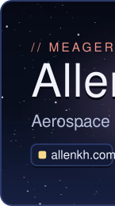
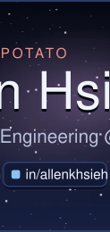
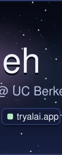

<!--
  This README is rebuilt by scripts/render.py every few hours.
  Edit profile/README.template.md instead, or your changes will be overwritten.
  The banner is four pictures side by side, one for each link, and the Recently card is a strip for each
  repo, stacked: scripts/render.py writes those two lines.
-->

